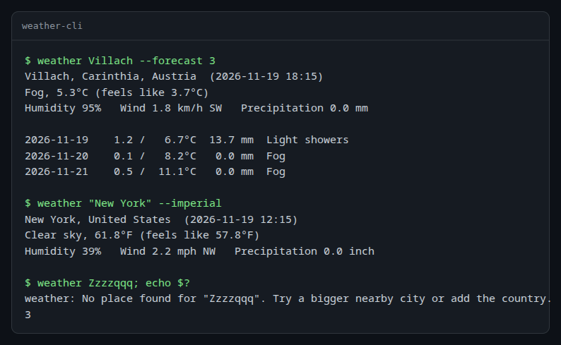

<div align="center">

# weather-cli

Current weather and a short forecast for any city, straight from the terminal. No account, no API key.

[](https://github.com/Wolfi-OwO/weather-cli/actions/workflows/ci.yml)
[](https://github.com/Wolfi-OwO/weather-cli/releases/latest)
[](LICENSE)


</div>



## Features

- **Current conditions:** temperature, feels-like, humidity, wind with a compass direction, precipitation and a plain-language description.
- **Forecast on request:** `--forecast 5` adds daily min/max, rain and conditions for up to 16 days.
- **Units:** metric by default, `--imperial` for °F, mph and inches.
- **Scriptable:** `--json` prints the whole result as JSON, and the exit code says what went wrong (see below).
- **Multi-word cities without quotes:** `weather Villach am See` works.

## Why it is built this way

- **Open-Meteo instead of OpenWeatherMap.** The first version of this tool used OpenWeatherMap and had its API key hard-coded in the source, which ended up in a public repository. Open-Meteo needs no key at all, so there is nothing to configure and nothing that can leak. This repository was started fresh for that reason.
- **Real JSON parsing.** The first version cut the response apart by character offsets and broke on any change of field order. It now uses Jackson.
- **Exit codes instead of stack traces.** An unknown city, a missing connection and a broken service are different failures, and a script wants to tell them apart.
- **Tests run against a local server** that imitates the two Open-Meteo endpoints, so CI does not depend on the internet or on today's weather.

## Getting started

Download the build for your system from the [latest release](https://github.com/Wolfi-OwO/weather-cli/releases/latest):

| File | What it is | Needs Java? |
|---|---|---|
| `weather-<version>-windows-x64.zip` | Unzip, run `weather\weather.exe` (unsigned, so Windows SmartScreen may warn: More info, Run anyway) | no |
| `weather-<version>-linux-x64.zip` | Unzip, run `weather/bin/weather` | no |
| `weather-<version>-macos-arm64.zip` | Apple Silicon only. Unzip, run `weather.app/Contents/MacOS/weather` (unsigned, so macOS may ask you to allow it) | no |
| `weather-<version>.jar` | `java -jar weather-<version>.jar Villach` | yes, 17 or newer |

Or build it yourself:

```bash
git clone https://github.com/Wolfi-OwO/weather-cli.git
cd weather-cli
./mvnw verify
java -jar target/weather.jar Villach --forecast 3
```

### Options

| Option | Meaning |
|---|---|
| `-f, --forecast[=DAYS]` | add a daily forecast, 1-16 days (3 if no number is given) |
| `-i, --imperial` | °F, mph, inches |
| `--json` | machine-readable output |
| `-h, --help` · `-V, --version` | usage and version |

### Exit codes

| Code | Meaning |
|---|---|
| 0 | success |
| 2 | invalid usage, for example `--forecast 99` |
| 3 | place not found |
| 4 | network error |
| 5 | weather service error |

## Tech stack

| | |
|---|---|
| Language | Java 17 (releases bundle their own runtime, built with Java 21's `jpackage`) |
| CLI parsing | [picocli](https://picocli.info) |
| JSON | Jackson |
| HTTP | `java.net.http.HttpClient` |
| Data | [Open-Meteo](https://open-meteo.com) forecast and geocoding APIs |
| Build and test | Maven (wrapper included), JUnit 5 |

## Project structure

```
src/main/java/dev/wolfi/weather/
  Main.java              # picocli command: options, exit codes
  OpenMeteoClient.java   # geocoding + forecast requests
  Renderer.java          # text and JSON output
  WeatherCode.java       # WMO weather codes and compass directions
  Models.java            # records for place, current weather, forecast
src/test/java/...        # end-to-end tests against a local fake API
.github/workflows/       # ci.yml (build + test on 3 systems), release.yml (tag -> release)
```

## CI/CD

- **CI** (`ci.yml`) builds, tests and smoke-tests the jar on Linux, Windows and macOS for every push and pull request.
- **Release** (`release.yml`) runs when a `v*` tag is pushed. It refuses a tag that does not match the version in `pom.xml`, then builds the jar and one `jpackage` bundle per system (the Windows one contains `weather.exe`), and publishes all of it with a `SHA256SUMS` file as a GitHub release.

To cut a release: bump `<version>` in `pom.xml`, commit, then `git tag v1.1.0 && git push origin v1.1.0`.

## Data source

Weather data comes from [Open-Meteo](https://open-meteo.com), which is free for non-commercial use and licensed [CC BY 4.0](https://creativecommons.org/licenses/by/4.0/). Please keep that in mind before using this for anything commercial.

## License

MIT, see [LICENSE](LICENSE).
